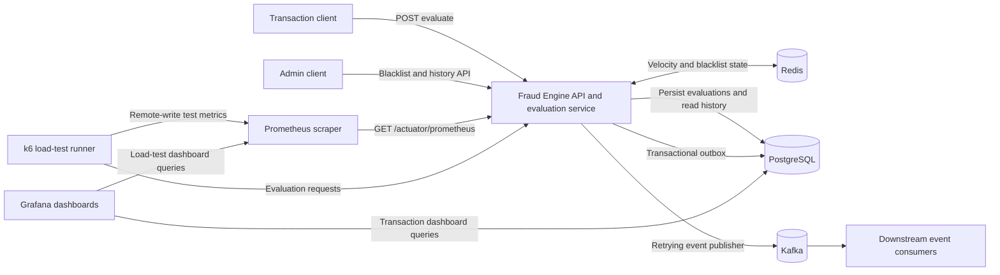

# Fraud Engine Architecture

## 1. Purpose and scope

The Fraud Engine is a synchronous Spring Boot service that evaluates payment
transactions using configurable fraud rules and returns an `APPROVE`, `REVIEW`,
or `DECLINE` decision. It enriches each request with account velocity and
blacklist state from Redis, then stores the transaction and its
evaluation in PostgreSQL for later retrieval and reporting.

This document describes the implementation in this repository. It is not a
deployment-scale or target-state design.

## 2. System context



The Docker Compose deployment runs the application, Redis, PostgreSQL, Kafka,
Prometheus, and Grafana. A one-shot k6 runner is available through the
`loadtest` profile. Grafana queries PostgreSQL directly for the transaction
dashboard and Prometheus for the load-test dashboard. Prometheus also scrapes
the application for HTTP metrics; k6 sends its run metrics to Prometheus using
the remote-write receiver.

## 3. Application structure

The code is organized as a modular monolith:

| Area | Responsibility |
| --- | --- |
| `api` | REST controllers, request/response DTOs, orchestration service, and API error handling. |
| `domain` | Transaction, evaluation context, rule result, risk, and decision types shared across the application. |
| `engine` | Rule ordering and execution, short-circuit behavior, audit listener dispatch, and fatal-engine-error handling. |
| `rules` | Stateless checks for blacklists, velocity, geographic anomalies, amount anomalies, and device trust. |
| `decision` | Aggregates triggered rule scores and maps scores or hard overrides to a decision. |
| `enrichment` | Contract for external context and the Redis implementation used in production. |
| `events` | Versioned evaluation-completed event contract and scheduled Kafka outbox publisher. |
| `persistence` | Evaluation history and outbox repositories, transactional persistence service, and classpath SQL query loading. |
| `config` | Spring bean wiring, engine/Kafka properties, PostgreSQL migration startup, OpenAPI, and HTTP Basic security. |

The decision path is synchronous. A background publisher sends committed
evaluation events from the PostgreSQL outbox to Kafka; downstream consumers
can process follow-up work asynchronously. No Kafka consumer is included in
this application.

## 4. Transaction evaluation flow

```mermaid
sequenceDiagram
    participant C as Client
    participant API as FraudEvaluationController
    participant S as FraudEvaluationService
    participant E as DefaultFraudEngine
    participant R as RedisContextEnricher
    participant Rules as Ordered fraud rules
    participant D as ThresholdDecisionEngine
    participant DB as PostgreSQL
    participant K as Kafka
    participant P as Outbox publisher

    C->>API: POST /api/v1/fraud/evaluate
    API->>S: Validated request DTO
    S->>S: Reject client-supplied customer profile; check timestamp skew
    S->>E: Evaluate transaction
    E->>R: Enrich transaction and default profile
    R-->>E: Velocity counts, latest transaction, blacklist hits
    E->>Rules: Evaluate enabled rules by priority
    Rules-->>E: Rule results (possibly short-circuited)
    E->>D: Aggregate results
    D-->>E: Decision and evaluated-rule summaries
    opt Decision is APPROVE and auto-record is enabled
        E->>R: Record transaction for future velocity checks
    end
    E-->>S: Fraud decision
    S->>DB: Persist evaluation and event in one transaction
    DB-->>S: Commit
    S-->>API: Evaluation response
    API-->>C: 200 response
    P->>DB: Claim pending outbox rows
    P->>K: Publish event (keyed by account ID)
    P->>DB: Mark sent or schedule retry
```

If Kafka is unavailable, evaluation persistence and the synchronous response
continue as long as PostgreSQL and Redis are available. Pending outbox rows
remain durable and are retried with bounded exponential backoff. Publishing is
at least once: a crash after broker acknowledgement but before the database
marks the row published may produce a duplicate. Consumers should deduplicate
by the stable `eventId` (the evaluation ID).

The request DTO requires transaction ID, account ID, and a positive amount.
Currency defaults to `ZAR` and timestamp defaults to the current time if not
provided. A supplied timestamp more than the configured future skew is
rejected. Clients cannot provide `customerProfile`; the service currently uses
a default profile for the account when invoking the engine.

Rules are sorted by ascending priority. The configured production rules are:

| Check | Purpose |
| --- | --- |
| Global blacklist | Hard-declines a matching account, IP address, or device. |
| Short-window velocity | Detects rapid pacing and elevated volume in one minute. |
| Transaction velocity | Detects elevated volume in ten minutes. |
| Impossible travel | Compares the current location and timestamp with the latest transaction. |
| Amount baseline deviation | Compares the amount against profile averages and an absolute threshold. |
| Device trust | Scores absent or unrecognized device fingerprints. |

With the default configuration, a triggered hard-block decline can stop later
rule evaluation. Otherwise, the decision engine sums triggered risk scores,
clamps the aggregate to 0–100, then compares it with the configured review and
decline thresholds. A hard-block override can directly produce a critical
decline independently of the aggregate score.

The default fatal engine-error behavior is fail-closed: the engine logs the
failure and returns a decline decision. This does not cover failures after the
engine returns; for example, a PostgreSQL persistence failure prevents the
service from returning a successful evaluation response.

## 5. State and persistence

### Redis: online evaluation state

`RedisContextEnricher` stores recent account transactions in Redis sorted sets,
using transaction timestamps as scores and serialized transactions as members.
Evaluation pipelines retrieve the counts for the preceding 1 minute, 10
minutes, and 24 hours; the latest transaction within 24 hours; and membership
in account, IP, and device blacklist sets.

Approved transactions are recorded automatically by default, after the
decision is computed. Velocity keys use the configurable `fraud:` prefix and
configured TTL (48 hours by default). Enrichment prunes entries older than 24
hours; velocity rules use the returned 1-minute and 10-minute counts. Blacklist
entries are added through the administrative API and are stored in Redis sets.

Redis provides online state for decisioning; it is not the durable evaluation
history store.

### PostgreSQL: durable evaluation history

`fraud_evaluations` stores one row per evaluation. The row includes identifiers,
event and evaluation timestamps, action, risk level and score, plus serialized
transaction and evaluation JSON. Transaction IDs may therefore have multiple
evaluation rows. Indexes support transaction history and account history
ordered by event/evaluation time.

Flyway applies schema migrations from `src/main/resources/db/migration` during
startup. Runtime SQL is kept separately in
`src/main/resources/db/queries` and loaded by the persistence layer. Repository
history APIs page results, with newest records first and a maximum page size of
100.

The `fraud_event_outbox` table stores a versioned
`FraudEvaluationCompletedEvent` payload and its delivery state. Evaluation and
outbox insertion share the same database transaction, preventing committed
decisions from being lost between database persistence and event publication.
The publisher claims rows in a short `FOR UPDATE SKIP LOCKED` transaction and
sets a lease before contacting Kafka, so database locks are not held during
network waits. It sends each claimed batch concurrently, then marks successful
deliveries or schedules failed sends for retry. Expired leases make claims
recoverable after a process crash. Publishing remains at least once; strict
ordering across multiple application instances is not guaranteed. The outbox
stores the account ID as the Kafka record key to group events by account
partition. Successfully delivered rows are retained for seven days by default
and purged daily.

## 6. HTTP API and security

The REST API is rooted at `/api/v1/fraud`:

| Endpoint | Access and purpose |
| --- | --- |
| `POST /evaluate` | Public synchronous transaction evaluation. |
| `GET /rules` | Lists active rules and metadata. |
| `GET /health` | Reports application readiness based on Redis and PostgreSQL availability. |
| `POST /blacklist` | Admin-only registration of an account, IP, or device blacklist entry. |
| `GET /evaluations/{evaluationId}` | Admin-only retrieval of one evaluation. |
| `GET /transactions/{transactionId}` | Admin-only retrieval of the most recently stored transaction. |
| `GET /transactions/{transactionId}/evaluations` | Admin-only paginated evaluation history. |
| `GET /accounts/{accountId}/transactions` | Admin-only paginated transaction history. |
| `GET /accounts/{accountId}/evaluations` | Admin-only paginated account evaluation history. |

Admin-only API endpoints and `GET /actuator/prometheus` use HTTP Basic
authentication with the configured admin user. Swagger UI and OpenAPI
endpoints are public. The configured admin username and password are required
at application startup.

## 7. Runtime, configuration, and observability

The application listens on port `8080` and runs in the Compose container as
non-root UID/GID `10001`. Spring Boot Actuator exposes health and Prometheus
metrics; the Prometheus scrape endpoint requires admin authentication. HTTP
request histograms support application latency dashboards. Evaluation
summaries include rule outcomes, while the audit listener logs the evaluation
ID, transaction/account identifiers, decision, score, rule count, and latency.

Runtime settings are defined in `src/main/resources/application.yml` and
overridden through environment variables. They cover decision thresholds,
Redis velocity state, database and broker connections, admin credentials, and
outbox delivery. See the README and `.env.example` for local setup and
environment-variable instructions.

Compose uses service discovery for PostgreSQL, Redis, and Kafka, and retains
PostgreSQL, Kafka, Prometheus, and Grafana data in named volumes. Kafka's
internal listener is `kafka:29092`; its plaintext host listener is bound to
`localhost:9092` for local development. Production deployments should
configure broker authentication, encryption, and network access controls.
Prometheus's remote-write receiver is intended for local development and
should not be exposed to untrusted networks.

The outbox publisher polls batches in the background, retries failures with
bounded backoff, and purges delivered rows after the configured retention
period. Its lease accounts for producer send blocking and the publish timeout.
The topic, batch, timeout, lease, and retention values are configurable under
`fraud.kafka`; their defaults and environment-variable names are documented in
`application.yml` and the README.

## 8. Extension points and constraints

- New rules implement `FraudRule`, provide metadata and a priority, and are
  registered as Spring beans. Rules are expected to be stateless and
  thread-safe.
- Alternate enrichment sources can implement `ContextEnricher`; the default
  configuration requires Redis unless a custom implementation is supplied.
- Decision logic can be replaced by providing another `DecisionEngine`.
- Additional audit listeners can implement `FraudAuditListener`. The listener
  contract expects non-blocking or asynchronous handling, but the current
  logging listener executes inline.
- Downstream systems can subscribe to the versioned Kafka completion topic;
  consumers should handle duplicate event IDs and tolerate event delivery
  delays.
- Persistent evaluation history is coupled to the PostgreSQL schema and JSON
  serialization stored by the JDBC repository. Changes to stored payloads or
  schema should preserve compatibility with existing rows or include an
  explicit migration strategy.
